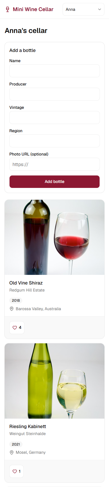
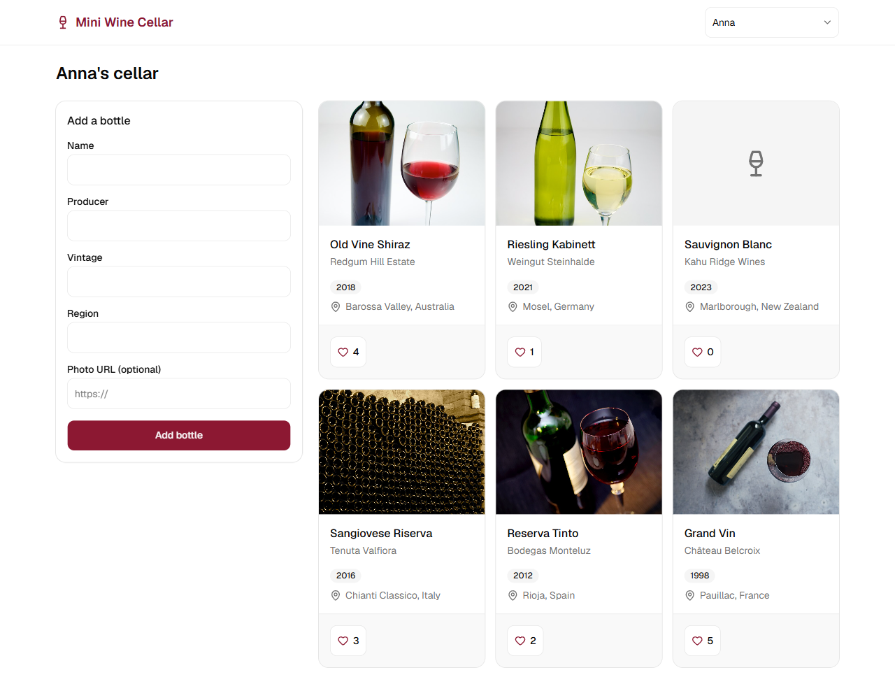

# Mini Wine Cellar

A small full-stack app where each user keeps a personal list of wine bottles, adds new ones in a few seconds and likes the ones they enjoy. Login is fake: pick a user from the header dropdown, and every request is scoped to that user.

A like is a counter: each click adds one, with an atomic `likes_count = likes_count + 1` on the server and an instant optimistic update in the browser. Every user sees only their own bottles, so "one like per user" would keep every count at 0 or 1; a counter is the only reading in which the like count means something ([D-1](docs/decisions.md#d-1-a-like-is-a-counter-with-an-atomic-sql-increment), [D-30](docs/decisions.md#d-30-why-a-like-is-a-counter-completes-d-1)).

| Mobile (375px) | Desktop (1280px) |
| --- | --- |
|  |  |

Demo: choose Anna, add a bottle, like one, switch to Mark.


Written answers to the five questions: [ANSWERS.md](ANSWERS.md).

## Features

- **Fake login.** The header dropdown lists the three seeded users. The choice is kept in `localStorage` and sent as the `x-user-id` header on every GraphQL request. Until a user is chosen, the page asks you to pick one.
- **Add a bottle.** Name, producer, vintage, region and an optional `https://` photo URL, with field-level messages on the client (Zod) and the same limits on the server (class-validator). The new bottle appears at the top of the list without a reload, with a "Bottle added" toast.
- **My bottles.** The current user's bottles, newest first, with a photo or placeholder, vintage, region and like count. Skeleton cards while loading, an empty state, and an error with "Try again".
- **Like.** The count updates at once through an Apollo `optimisticResponse` and rolls back if the server fails.

## Stack

| Area | Tech |
| --- | --- |
| Monorepo | npm workspaces: `apps/api`, `apps/web`, `packages/shared` |
| API | NestJS 11 on Express 5, GraphQL code-first with Apollo Server 5 (`@nestjs/apollo`), class-validator, TypeScript 6 |
| Database | PostgreSQL 18 (docker-compose), MikroORM 6 with migrations and a seeder |
| Web | Next.js 16 (App Router), React 19, Apollo Client 4 with GraphQL Codegen, react-hook-form + Zod 4, Tailwind CSS 4, shadcn/ui |
| Shared | `@mini-wine-cellar/shared`: the validation limits both apps import |
| Tooling | Biome (lint and format), Jest in every workspace, `concurrently` for `npm run dev` |

## Prerequisites

- Node 22.13+ or 24+ (`engines` `^22.13.0 || >=24.0.0`, tested on Node 26)
- npm 10+ (tested with npm 11)
- Docker (for Postgres)

## Run it

```bash
npm install
docker compose up -d
npm run db:migrate
npm run db:seed
npm run dev
```

- Web: http://localhost:3000
- GraphQL API: http://localhost:4000/graphql

`npm install` also builds `packages/shared`. Postgres needs a few seconds to start: if `db:migrate` cannot connect, wait until `docker compose ps` shows the container as `healthy` and run it again.

`npm run db:seed` creates the three users and six demo bottles for Anna. Mark and Taras start empty on purpose, to show the empty state. Running the seed again resets the demo bottles (likes included) and keeps bottles you added yourself.

## Environment files

None are needed for `npm run dev`: the api falls back to the docker-compose database and port 4000 ([D-18](docs/decisions.md#d-18-database_url-falls-back-to-the-docker-compose-defaults)), and the web app falls back to `http://localhost:4000/graphql` ([D-26](docs/decisions.md#d-26-next_public_api_url-falls-back-to-localhost-outside-production)). To change a value, copy the examples:

```bash
cp apps/api/.env.example apps/api/.env
cp apps/web/.env.example apps/web/.env.local
```

| File | Variables |
| --- | --- |
| `apps/api/.env` | `PORT` (4000), `DATABASE_URL`, `CORS_ORIGIN` (`http://localhost:3000`) |
| `apps/web/.env.local` | `NEXT_PUBLIC_API_URL` (`http://localhost:4000/graphql`) |

### Production build

Copy `apps/web/.env.example` to `apps/web/.env.local` before `npm run build`. A production build without `NEXT_PUBLIC_API_URL` fails on purpose with "NEXT_PUBLIC_API_URL must be set when NODE_ENV is production", so a bundle can never point at localhost by accident ([D-26](docs/decisions.md#d-26-next_public_api_url-falls-back-to-localhost-outside-production)). The api follows the same rule: started with `NODE_ENV=production`, it needs `DATABASE_URL` and `CORS_ORIGIN` ([D-18](docs/decisions.md#d-18-database_url-falls-back-to-the-docker-compose-defaults), [D-35](docs/decisions.md#d-35-cors_origin-is-required-in-production)).

```bash
cp apps/web/.env.example apps/web/.env.local
npm run build
```

## Scripts

Run from the repo root.

| Script | What it does |
| --- | --- |
| `npm run dev` | api on 4000 and web on 3000 in parallel |
| `npm run lint` | Biome check for every workspace (`npm run format` fixes) |
| `npm run typecheck` | `tsc` in each workspace with its own TypeScript version |
| `npm test` | Jest in every workspace |
| `npm run build` | shared, api and web production builds |
| `npm run codegen -w web` | regenerates `apps/web/src/gql/` from `apps/api/schema.gql` |
| `npm run db:migrate` | applies MikroORM migrations |
| `npm run db:seed` | seeds the users and Anna's demo bottles |

The api writes `apps/api/schema.gql` on every dev start. Both the schema and the generated web types are committed, so typecheck and build work without a running API.

## Fake login and ownership

- `query users` is the only public operation: the dropdown needs it before anyone is "logged in".
- Every other operation goes through `UserIdGuard` (`apps/api/src/auth/user-id.guard.ts`). It reads `x-user-id`, loads the user and puts it into the GraphQL context; a missing, malformed or unknown id is `UNAUTHENTICATED`. Resolvers read the user through `@CurrentUser()`, and the guard is the only place that knows how a user is identified, so real auth (for example Cognito) would replace only the guard ([D-3](docs/decisions.md#d-3-the-guard-is-the-only-place-that-knows-how-a-user-is-identified)).
- `myBottles` filters by the current user, and `addBottle` takes the owner from the context, never from the input.
- `likeBottle` is one conditional `UPDATE ... WHERE id = ? AND owner_id = ?`, then a separate query reads the row back for the response ([D-32](docs/decisions.md#d-32-likebottle-is-one-atomic-update-plus-a-separate-read-corrects-d-1)). Another user's bottle and a missing id both return `NOT_FOUND`, so the response never reveals that someone else's id exists ([D-2](docs/decisions.md#d-2-another-users-bottle-returns-notfound-not-forbidden)).
- There is no edit or delete: the like is the only change to an existing bottle.

## Project layout

```text
apps/
  api/                    NestJS GraphQL API (port 4000)
    src/auth/             x-user-id guard and @CurrentUser()
    src/bottles/          entity, GraphQL model, input, resolver, service
    src/users/            entity, model, resolver, service
    src/graphql/          formatError, the one place errors are mapped
    src/migrations/       MikroORM migrations
    src/seeders/          users and demo bottles
    schema.gql            generated GraphQL schema (committed)
  web/                    Next.js app (port 3000)
    src/app/              layout, page, styles, favicon
    src/components/       cellar UI; ui/ holds the shadcn components
    src/graphql/          GraphQL documents
    src/gql/              Codegen output (committed)
    src/lib/              Apollo client, Zod schema, user store, helpers
packages/
  shared/                 validation limits used by both apps
docs/                     decisions, screenshots, demo GIF
context/                  project overview, coding standards, specs
.claude/                  Claude Code skills, agents and settings
```

## Decisions

Non-obvious choices, each with its context, alternatives and reason, are in [docs/decisions.md](docs/decisions.md).

## How I worked

I built the app with Claude Code on top of my own harness, which lives in the repo. `.claude/` holds the skills I call as slash commands (`/specs` turns the brief into an overview and specs, `/feature` runs one spec from load to merge, `/cleanup` checks housekeeping), the `code-scanner` review agent, and `settings.json` with the allowed commands, the enabled MCP servers (Context7 for current library docs, Playwright for the browser) and deny rules for reading `.env` files with the Read tool. `context/` holds what the AI reads before every task: `project-overview.md` (the problem, features, GraphQL contract, data model and assumptions), `coding-standards.md` and `ai-interaction.md` (code style, git workflow and working rules), the specs in `context/features/`, and `current-feature.md`, the working file of the spec in progress. `CLAUDE.md` and `AGENTS.md` record the installed versions, because several libraries here are newer than the model's training data.

The work went from the brief to `project-overview.md`, then to seven small specs, each with requirements, notes and testing steps. Every spec ran through one `/feature` loop on its own branch: `load` turned it into a checklist, `start` implemented it, `test` added unit tests for the logic, and `review` compared the result with the plan. Every spec got a code review, every spec that changed application code also got a `code-scanner` pass, and the whole diff went through `code-scanner` once more before the PR; I fixed the findings and ran lint, typecheck, tests and build before each merge. `complete` then merged the branch into `feat/wine-cellar` with `--no-ff`, so each spec is visible in the history.

Each non-obvious decision went into `docs/decisions.md` when its spec was completed, so the reasoning stays next to the code instead of in chat history.

## Troubleshooting

- **Port 5432 is already in use.** A local Postgres is running. Stop it, or change the host port in `docker-compose.yml` (for example `"127.0.0.1:5433:5432"`) and set the same port in `DATABASE_URL` in `apps/api/.env`.
- **Ports 3000 or 4000 stay busy after stopping `npm run dev` (Windows).** Node processes can outlive the terminal. Find them with `netstat -ano | findstr :3000` (or `:4000`) and end each with `taskkill /PID <pid> /T /F`.
- **`EPERM: operation not permitted, rename ... .next\dev\...` from `next dev` right after `next build`.** Stop dev, delete `apps/web/.next`, and start `npm run dev` again.
- **`npm install` warns that install scripts were not run** (npm 11 lists `unrs-resolver`, `@apollo/protobufjs` and `@parcel/watcher` under `install-scripts`). This is harmless: the app, tests and build work without those scripts (checked on a clean clone), so there is nothing to approve.

## Photo credits

The demo bottles hotlink these photos from Wikimedia Commons:

| Bottle | Photo | Author | License |
| --- | --- | --- | --- |
| Grand Vin, Château Belcroix | [Red wine bottle and glass on a gray surface](https://commons.wikimedia.org/wiki/File:Red_wine_bottle_and_glass_on_a_gray_surface_during_an_evening_gathering.jpg) | Shixart1985 | [CC BY 2.0](https://creativecommons.org/licenses/by/2.0) |
| Sangiovese Riserva, Tenuta Valfiora | [Sangiovese bottles aging in cellar](https://commons.wikimedia.org/wiki/File:Sangiovese_bottles_aging_in_cellar.jpg) | bradleypjohnson | [CC BY 2.0](https://creativecommons.org/licenses/by/2.0) |
| Riesling Kabinett, Weingut Steinhalde | [Glass of White Wine shot with a bottle of white wine](https://commons.wikimedia.org/wiki/File:Glass_of_White_Wine_shot_with_a_bottle_of_white_wine_-_Evan_Swigart.jpg) | Evan Swigart | [CC BY 2.0](https://creativecommons.org/licenses/by/2.0) |
| Old Vine Shiraz, Redgum Hill Estate | [Glass of Red Wine with a bottle of Red Wine](https://commons.wikimedia.org/wiki/File:Glass_of_Red_Wine_with_a_bottle_of_Red_Wine_-_Evan_Swigart.jpg) | Evan Swigart | [CC BY 2.0](https://creativecommons.org/licenses/by/2.0) |
| Reserva Tinto, Bodegas Monteluz | [Bottle and glass of red wine](https://commons.wikimedia.org/wiki/File:Bottle_and_glass_of_red_wine.jpg) | congerdesign | [CC0 1.0](https://creativecommons.org/publicdomain/zero/1.0/) |

The wines and producers are fictional; the regions are real.
